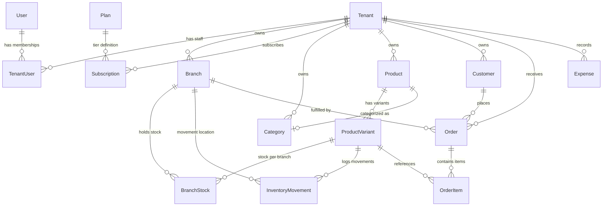

# Database Schema & Entity Relationships

ShopFlow POS utilizes **PostgreSQL** with **Prisma ORM**. The schema is defined in `server/prisma/schema.prisma`.

---

## 1. Entity-Relationship Overview

---

## 2. Models & Field Descriptions

### 1. `User`
Global platform user table.
- `id` (String, cuid): Primary key.
- `name` (String): Full name.
- `email` (String, unique): Login identifier (lowercased, trimmed).
- `password` (String): Bcrypt hashed password.
- `isPlatformAdmin` (Boolean, default `false`): Flag granting access to Super Admin Panel.
- `createdAt` / `updatedAt` (DateTime).

### 2. `Tenant`
Represents an individual online/retail shop.
- `id` (String, cuid): Primary key.
- `name` (String): Shop display name.
- `slug` (String, unique): URL-friendly slug (e.g. `demo-shop`).
- `phone` (String, optional): Store contact number.
- `status` (String, default `'active'`): Can be `'active'` or `'suspended'`.
- `createdAt` / `updatedAt` (DateTime).

### 3. `TenantUser`
Many-to-many join table linking users to shops with roles and permissions.
- `id` (String, cuid): Primary key.
- `tenantId` (String): Foreign key to `Tenant` (Cascade delete).
- `userId` (String): Foreign key to `User` (Cascade delete).
- `branchId` (String, optional): Assigned branch location.
- `role` (String, default `'owner'`): Role (`'owner'`, `'manager'`, `'cashier'`, `'staff'`).
- `permissions` (Json): Permissions object `{ pos, inventory, orders, customers, reports, manageStaff }`.
- `Unique constraint`: `@@unique([tenantId, userId])`.

### 4. `Branch`
Physical store locations / warehouses under a tenant.
- `id` (String, cuid): Primary key.
- `tenantId` (String): Foreign key to `Tenant`.
- `name` (String): Branch name (e.g. `'Main Branch'`).
- `address` (String, optional): Street address.
- `phone` (String, optional): Branch contact phone.
- `isMain` (Boolean, default `false`): Flags headquarters branch.
- `isActive` (Boolean, default `true`).
- `Unique constraint`: `@@unique([tenantId, name])`.

### 5. `Plan`
Global SaaS subscription plans managed by Super Admin.
- `id` (String, cuid): Primary key.
- `name` (String): Plan name (`'Starter'`, `'Standard'`, `'Business'`).
- `price` (Decimal 12,2): Price in MMK.
- `durationDays` (Int, default `30`): Validity duration in days.
- `isActive` (Boolean, default `true`).

### 6. `Subscription`
Tenant SaaS subscription records and payment proofs.
- `id` (String, cuid): Primary key.
- `tenantId` (String): Foreign key to `Tenant`.
- `planId` (String): Foreign key to `Plan`.
- `status` (String, default `'pending'`): `'trial'`, `'active'`, `'pending'`, `'expired'`, `'suspended'`.
- `startsAt` (DateTime): Plan activation timestamp.
- `expiresAt` (DateTime): Plan expiration timestamp.
- `amountDue` (Decimal 12,2): Bill amount in MMK.
- `amountPaid` (Decimal 12,2): Verified amount paid.
- `paymentMethod` (String, optional): `'KBZPay'`, `'WavePay'`, `'CASH'`, etc.
- `paymentSlipUrl` (String, optional): Link or path to bank transfer screenshot.
- `paymentStatus` (String, default `'pending'`): `'pending'`, `'paid'`, `'rejected'`, `'not_required'`.

### 7. `Category`
Product category groupings within a shop.
- `id` (String, cuid): Primary key.
- `tenantId` (String): Foreign key to `Tenant`.
- `name` (String): Category name (e.g. `'Beverages'`).
- `Unique constraint`: `@@unique([tenantId, name])`.

### 8. `Product` & `ProductVariant`
Product catalog and SKU/pricing variants.
- **`Product`**:
  - `id` (String, cuid): Primary key.
  - `tenantId` (String): Foreign key to `Tenant`.
  - `categoryId` (String, optional): Foreign key to `Category`.
  - `name` (String): Product name.
  - `sku` (String): Base catalog SKU.
  - `description` (String, optional).
  - `isActive` (Boolean, default `true`).
  - `Unique constraint`: `@@unique([tenantId, sku])`.
- **`ProductVariant`**:
  - `id` (String, cuid): Primary key.
  - `productId` (String): Foreign key to `Product`.
  - `name` (String): Variant title (e.g. `'Standard'`, `'Small'`, `'Large'`).
  - `sku` (String, unique): Barcode or variant SKU.
  - `costPrice` (Decimal 12,2): Wholesale/acquisition unit cost.
  - `sellingPrice` (Decimal 12,2): Retail unit price.
  - `stock` (Int, default `0`): Aggregate stock quantity across branches.

### 9. `BranchStock`
Per-branch stock inventory allocation.
- `id` (String, cuid): Primary key.
- `branchId` (String): Foreign key to `Branch`.
- `variantId` (String): Foreign key to `ProductVariant`.
- `quantity` (Int, default `0`): Quantity on hand in this branch.
- `Unique constraint`: `@@unique([branchId, variantId])`.

### 10. `Customer`
Customer relationship directory.
- `id` (String, cuid): Primary key.
- `tenantId` (String): Foreign key to `Tenant`.
- `name` (String): Customer full name.
- `phone` (String, optional): Mobile phone.
- `address` (String, optional): Delivery address.

### 11. `Order` & `OrderItem`
POS retail sales and orders.
- **`Order`**:
  - `id` (String, cuid): Primary key.
  - `tenantId` (String): Foreign key to `Tenant`.
  - `branchId` (String, optional): Originating branch.
  - `customerId` (String, optional): Null for Walk-in Customer.
  - `orderNumber` (String): Unique invoice number (e.g. `SF-1002`).
  - `subtotal`, `discount`, `deliveryFee`, `total` (Decimal 12,2).
  - `status` (String): `'PENDING'`, `'CONFIRMED'`, `'PACKING'`, `'SHIPPED'`, `'DELIVERED'`, `'CANCELLED'`.
  - `paymentStatus` (String): `'PAID'`, `'UNPAID'`, `'PARTIAL'`, `'REFUNDED'`.
  - `paymentMethod` (String): `'CASH'`, `'KBZPay'`, `'WavePay'`, etc.
  - `Unique constraint`: `@@unique([tenantId, orderNumber])`.
- **`OrderItem`**:
  - `id` (String, cuid): Primary key.
  - `orderId` (String): Foreign key to `Order`.
  - `variantId` (String): Foreign key to `ProductVariant`.
  - `productName` (String): Captured snapshot of product title.
  - `variantName` (String, optional).
  - `quantity` (Int).
  - `unitPrice` (Decimal 12,2): Captured sale price.
  - `unitCost` (Decimal 12,2): Captured cost for accurate historical COGS calculations.
  - `total` (Decimal 12,2): `unitPrice * quantity`.

### 12. `InventoryMovement`
Warehouse audit log tracking every inventory change.
- `id` (String, cuid): Primary key.
- `variantId` (String): Foreign key to `ProductVariant`.
- `branchId` (String, optional): Location of movement.
- `type` (String): `'IN'` (intake/restock), `'OUT'` (sales deduction), `'ADJUST'` (manual count correction).
- `quantity` (Int): Absolute quantity moved.
- `note` (String, optional): Reason / Order reference.

### 13. `Expense`
Store operating overhead.
- `id` (String, cuid): Primary key.
- `tenantId` (String): Foreign key to `Tenant`.
- `title` (String): Title (e.g. `'Electricity Bill'`).
- `amount` (Decimal 12,2): Expense cost.
- `description` (String, optional).
- `createdAt` (DateTime): Expense date.
